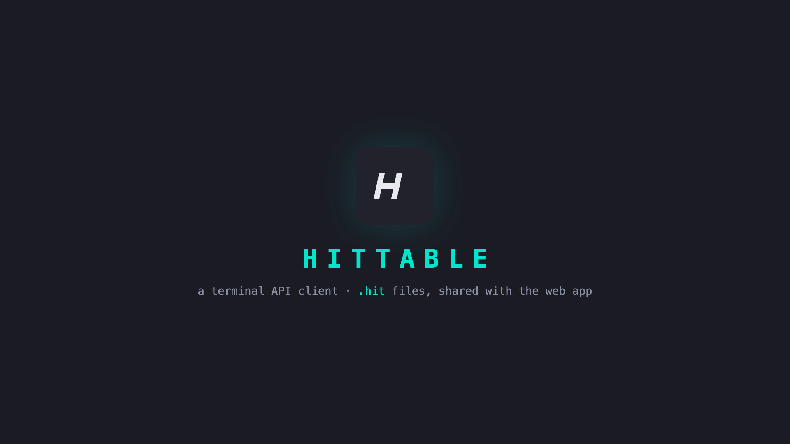
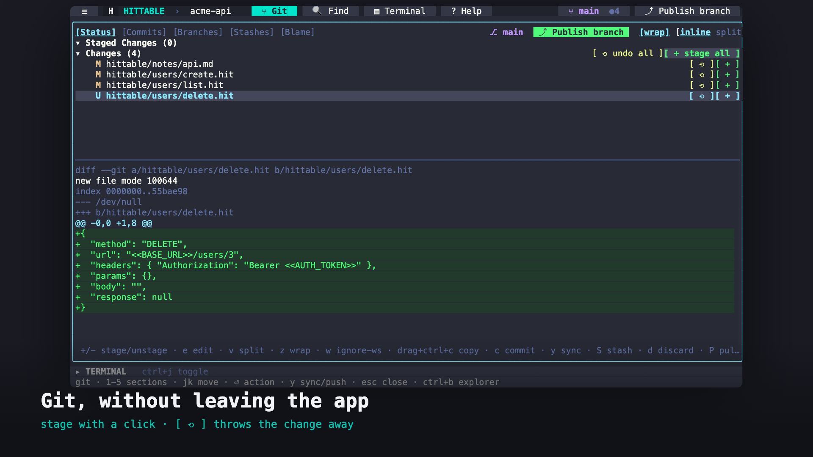

<p align="center">
  
</p>

<h1 align="center">Hittable</h1>

<p align="center">
  An open-source, local-first API client. Your requests are plain <code>.hit</code> files in your own repository.
</p>

<p align="center">
  <a href="https://hittable.vercel.app/hittable">Web app</a> ·
  <a href="https://hittable.vercel.app/docs">Documentation</a> ·
  <a href="https://hittable.vercel.app/docs/shellapp">Terminal app</a>
</p>

## What it is

Hittable keeps every request as a small JSON file (`.hit`) in a `hittable/` folder, next to your code. Variables live in `hittable/env.json`, with a git-ignored `hittable/env.local.json` for real secrets. There is no Hittable account and no database. Two tools work on the same files:

- **The web app** at [hittable.vercel.app/hittable](https://hittable.vercel.app/hittable), or self-hosted.
- **The terminal app**, `hittable`, a single Go binary with an editor, a Git panel and a shell.

Edit a request in the browser, run it from the terminal, commit it, and your team gets it with `git pull`.

## Web app

There are two ways to open a workspace:

- **Sign in with GitHub** (v3, being rolled out). Pick one of your repositories; the picker has search, owner filters, a Recent list, and badges for Private, Fork, Archived and Read-only repositories. The repository's `.hit` files open in the workspace. Edits are kept as a working copy on this device (IndexedDB) until you review the diff and commit, either to the branch or to a new branch with a pull request.
- **Open a local folder**. No account. Uses the File System Access API (Chrome and Edge) and autosaves to disk.

In both modes you get:

- a request runner with params, headers and body types (None, JSON, Text, Form)
- `<<KEY>>` variables from `hittable/env.json` and `hittable/env.local.json`
- a production guard: set `HITTABLE_PRODUCTION=true` and unsafe methods ask before sending
- a response viewer with a JSON tree, raw text, a sandboxed HTML preview, search, a JSONPath filter, and compare against the previous response
- copy as cURL, JavaScript fetch, Python requests or HTTPie
- share links that carry the request in the URL fragment, with credentials replaced by variables; nothing is uploaded
- paste a curl command into the URL bar to fill in the request
- a CodeMirror editor for every file, a command palette (`Ctrl/Cmd+K`) and keyboard shortcuts (`?`)

**GitHub access.** The app asks for `repo` (list your repositories, read their `.hit` files and commit changes) and `read:user` (your name and avatar). Nothing admin-, organisation- or workflow-specific. The token stays on the server in an AES-256-GCM encrypted, `HttpOnly` cookie and is never readable by page JavaScript; every GitHub call goes through `/api/github/*`. Signing out revokes the grant, and you can revoke it any time in [GitHub settings](https://github.com/settings/applications). Organisations may need to approve the app before their repositories appear.

**Localhost.** Remote requests go through the app's `/api/proxy` to avoid CORS. A server cannot reach your machine, so requests to `localhost` and `127.0.0.1` go through the [browser extension](https://hittable.vercel.app/docs/browser-extension) (Chrome, loaded unpacked from the latest release).

## Terminal app

```sh
curl -fsSL https://raw.githubusercontent.com/Pantho-Haque/hittable/main/install.sh | sh
cd your-repo && hittable
```

It reads and writes the same `.hit` files and `env.json` as the web app. Beyond requests it has syntax highlighting, folding, completion, markdown preview, fuzzy find and grep, an integrated shell, and a Git panel (status, commits, branches, stashes, blame, inline or side-by-side diffs). It also imports and exports Postman and Insomnia collections (`hittable -i`, `hittable -e`). Commit messages can be drafted by a small model that runs only on your machine, and only after you opt in with `hittable model enable`.



See the [terminal app docs](https://hittable.vercel.app/docs/shellapp) and [`shellapp/README.md`](shellapp/README.md).

## Self-hosting

One Next.js 16 app, no database. Deploy to Vercel or any Node 22.19+ host, or use the `Dockerfile`.

[](https://vercel.com/new/clone?repository-url=https://github.com/Pantho-Haque/hittable)

GitHub sign-in needs a GitHub OAuth App (GitHub → Settings → Developer settings → OAuth Apps) with the callback URL `https://<host>/api/github/callback`, and these variables:

| Variable | |
| :--- | :--- |
| `GITHUB_CLIENT_ID` | the OAuth app's client ID |
| `GITHUB_CLIENT_SECRET` | the OAuth app's client secret |
| `SESSION_SECRET` | at least 32 bytes, e.g. `openssl rand -base64 32` |
| `APP_URL` | optional: the public origin, when a reverse proxy rewrites `Host` |

Without them sign-in is unavailable and **Open a local folder** still works. The proxy's optional limits (`PROXY_*`) are listed in `.env.example`. Full guide: [Self-hosting](https://hittable.vercel.app/docs/self-hosting).

## Development

```sh
pnpm install
pnpm dev          # http://localhost:3000
pnpm lint
pnpm typecheck
pnpm test         # Vitest unit and component tests
pnpm build        # production build
pnpm start        # serve the build
pnpm test:e2e     # Playwright, against a production build, a fake API and a fake GitHub
```

Node 22.19 or newer, pnpm. Commits follow Conventional Commits, checked by commitlint. See [Development](https://hittable.vercel.app/docs/development).

## Project structure

```
app/                  Next.js routes: landing page, /hittable, /docs, /api/proxy, /api/github/*
components/           workspace, request form and response panel, palette, docs, landing page
context/ hooks/       workspace, shortcuts and notification state
utils/                curl, codegen, JSONPath, JSON diff, share links, env resolution
utils/server/github/  OAuth, encrypted session cookie, GitHub client, commits
content/docs/         the documentation, one markdown file per page
browserExtension/     the Chrome extension for localhost requests
shellapp/             the Go terminal app
hittable/             an example project folder
tests/                Vitest (unit) and Playwright (e2e)
```

## Documentation

Everything is at **[hittable.vercel.app/docs](https://hittable.vercel.app/docs)**: [getting started](https://hittable.vercel.app/docs/getting-started), the [`.hit` format](https://hittable.vercel.app/docs/project-format), the [web app](https://hittable.vercel.app/docs/web-app), the [terminal app](https://hittable.vercel.app/docs/shellapp) and the [FAQ](https://hittable.vercel.app/docs/faq). The pages are markdown in [`content/docs/`](content/docs/); edit one and open a pull request.

## Contributing

Issues and pull requests are welcome on [GitHub](https://github.com/Pantho-Haque/hittable/issues). Branch from `main`, keep commits conventional, and run `pnpm lint`, `pnpm typecheck` and `pnpm test` before opening a pull request.
